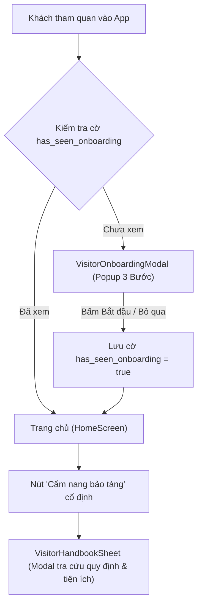

# Bản đặc tả kỹ thuật: Sổ tay hướng dẫn & Cẩm nang Khách tham quan (Visitor Guidebook Spec)
**Dự án:** Smart Museum Guide System (SMGS)  
**Tác giả:** Antigravity Pairing Assistant  
**Ngày lập:** 07/11/2026

---

## 1. Kiến trúc thành phần (Component Architecture)

### 1.1. `VisitorOnboardingModal` (Popup Chào mừng 3 bước)
* **Vị trí hiển thị:** Xuất hiện ở trung tâm màn hình sau khi ứng dụng tải xong dữ liệu bảo tàng ở lần chạy đầu tiên.
* **Cấu trúc Slide (3 Bước):**
  1. **Slide 1 — Nhận diện Di sản:**
     - *Huy hiệu:* `BƯỚC 1 · TƯƠNG TÁC`
     - *Tiêu đề:* `Quét mã & Nhận diện Hiện vật`
     - *Nội dung:* Chạm biểu tượng Quét mã QR tại chân tủ kính hoặc sử dụng AI Vision để mở hồ sơ lịch sử chỉ trong 1 giây.
     - *Icon minh họa:* `Icons.qr_code_scanner_rounded` / `Icons.center_focus_strong_rounded`.
  2. **Slide 2 — Giọng đọc Lịch sử:**
     - *Huy hiệu:* `BƯỚC 2 · LẮNG NGHE`
     - *Tiêu đề:* `Thuyết minh Âm thanh AI Đa ngữ`
     - *Nội dung:* Lắng nghe câu chuyện khảo cổ sống động được AI tổng hợp theo kịch bản chuẩn của Giám tuyển; tùy chỉnh tốc độ đọc phù hợp với bạn.
     - *Icon minh họa:* `Icons.headphones_rounded` / `Icons.record_voice_over_rounded`.
  3. **Slide 3 — Định vị & Dẫn lối:**
     - *Huy hiệu:* `BƯỚC 3 · KHÁM PHÁ`
     - *Tiêu đề:* `Sơ đồ Tầng & Chỉ đường Thông minh`
     - *Nội dung:* Không lo lạc lối giữa các gian trưng bày. Bản đồ số tự động tính toán lộ trình Dijkstra ngắn nhất đưa bạn đến tận hiện vật.
     - *Icon minh họa:* `Icons.explore_rounded` / `Icons.directions_walk_rounded`.
* **Nút điều hướng:**
  - Nút *Bỏ qua* (Skip) ở góc trên bên phải.
  - Chấm tròn chỉ thị vị trí slide (Dot Indicators).
  - Nút *Tiếp theo* (Next) chuyển slide; ở slide cuối chuyển thành *Bắt đầu Khám phá* (Get Started).

---

### 1.2. `VisitorHandbookSheet` (Cẩm nang Tra cứu Thường trực)
* **Vị trí truy cập:** Được đặt thành một thẻ Action hoặc biểu tượng Book nổi bật tại thanh AppBar / Quick Action của HomeScreen.
* **Nội dung hiển thị (3 Phần):**
  1. **Phần A — Mẹo Khám phá Công nghệ:**
     - Cách quét QR nhanh khi ánh sáng yếu.
     - Cách nghe audio bằng tai nghe cá nhân để có trải nghiệm sâu lắng nhất.
     - Cách chuyển đổi giữa các tầng trên sơ đồ indoor.
  2. **Phần B — Văn hóa & Quy định Bảo tàng:**
     - Giữ khoảng cách và không chạm tay vào hiện vật trưng bày.
     - Tắt đèn Flash khi chụp ảnh để bảo tồn chất liệu cổ vật.
     - Giữ trật tự chung, chuyển điện thoại sang chế độ rung.
  3. **Phần C — Bản đồ Tiện ích & Trợ giúp:**
     - Vị trí tủ gửi đồ miễn phí tại sảnh chính.
     - Lối đi ưu tiên và nhà vệ sinh hỗ trợ xe lăn.
     - Đường dây nóng bảo vệ / hỗ trợ y tế khẩn cấp: `024.3825.2853`.

---

## 2. Quy chuẩn Thiết kế Heritage Editorial (Design Standards)

* **Bảng màu:**
  - `Burgundy`: `#800020` (Điểm nhấn trang trọng, nút hành động chính).
  - `Muted Gold`: `#C5A059` (Đường viền vi mô, huy hiệu bước, icon).
  - `Antique Ivory`: `#FAF7F2` (Màu nền giấy di sản, tạo sự ấm cúng, thư thái).
  - `Charcoal Ink`: `#1F1D1A` (Màu mực chữ đậm, độ tương phản cao, dễ đọc).
* **Typography:**
  - Tiêu đề: Font Serif trang nhã, kerning rộng nhẹ.
  - Thân bài: Font Sans-serif chuẩn mực, khoảng cách dòng `height: 1.5` giúp mắt không bị mỏi.
* **Viền & Đổ bóng:**
  - Border mảnh `1px solid rgba(197, 160, 89, 0.3)`.
  - Box shadow dạng lớp phủ khuếch tán mềm (`boxShadow: [BoxShadow(color: Color(0x14000000), blurRadius: 24, offset: Offset(0, 8))]`).

---

## 3. Quản lý Trạng thái & Dữ liệu (State Management)

* Sử dụng `SharedPreferences` trong Flutter:
  - Khóa: `has_seen_visitor_onboarding_v1` (Boolean).
  - Khi người dùng bấm *Bắt đầu khám phá* hoặc *Bỏ qua*, lưu `true`.
* Cung cấp nút *"Xem lại hướng dẫn nhập môn"* ngay bên trong `VisitorHandbookSheet` để khách có thể bật lại modal chào mừng bất cứ khi nào muốn.
